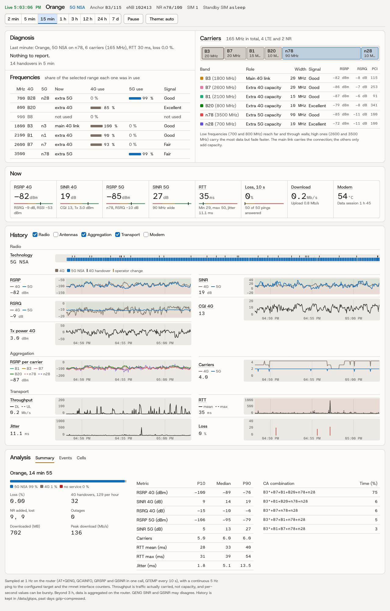

# glqos — live 4G/5G QoS dashboard for the GL.iNet GL-E5800 (Mudi 7)

*[Version française](README.fr.md)*

`glqos` turns the GL-E5800 into its own radio analyser: the router samples its Quectel
RG650V modem every second, pings a target five times per second, and serves a live
dashboard on the LAN with history. An optional second package, `glqos-simguard`, fixes
the packet loss caused by the second SIM (see [Why the second SIM hurts](#why-the-second-sim-hurts)).

<picture>
  <source media="(prefers-color-scheme: dark)" srcset="docs/screenshot-dark.png">
  
</picture>

Not affiliated with GL.iNet or Quectel.

## Features

- **1 Hz radio sampling** in a single AT call (`AT+QENG`, `QCAINFO`, `QRSRP`, `QSINR`; `QTEMP` every 10 s):
  RAT (LTE / NR NSA), serving cell (band, PCI, EARFCN, eNB, TAC), RSRP / RSRQ / SINR / RSSI / CQI / Tx power,
  per-antenna RSRP and SINR (4 RX chains, LTE and NR), every aggregated carrier, modem temperature.
- **5 Hz ping** to a configurable target: RTT, jitter, loss (from sequence gaps).
- **Carried throughput** from the rmnet counters, data session state, operator (MCC-MNC), active SIM.
- **Live dashboard** (`http://<router LAN IP>:8088/`), refreshed every second, no external dependency
  (works when the uplink is down), light and dark themes:
  - a plain-language **diagnosis** of the last minute that lists only what needs attention, with the likely cause;
  - a **frequency map** (700 to 3500 MHz): what is in use now and how often over the selected range;
  - the aggregated **carriers** with frequency, role, width and a signal word anyone can read;
  - live figures, stacked synchronised charts, events (handovers, NR added/lost, CA changes, loss bursts,
    outages, reconnections, operator switches), per-cell statistics and a per-operator summary;
  - an explanation behind every label. Ranges from 2 minutes to 7 days.
- **History** in `/data/glqos`: one CSV per day, past days gzip-compressed (~4 MB/day instead of ~19), 30 days by default.
- **Survives firmware upgrades**: files are declared in `/lib/upgrade/keep.d`, which GL's A/B upgrade
  (`abfota_update`) restores; history lives on `/data`, which upgrades do not wipe.

## Why the second SIM hurts

The GL-E5800 is dual-SIM dual-standby with a **single radio**. With both SIMs registered, the idle SIM
regularly takes the radio away from the SIM carrying data (paging, measurements, cell reselection,
tracking area updates). The data path stalls for 1 to 13 seconds and packets are lost, much more on the move.

Measured on 2026-11-11 (5 Hz ping to 8.8.8.8, same SIM as a Pixel 10 placed next to the router, same place and time):

| Mudi 7 configuration | Loss | RTT p95 | RTT max |
|---|---|---|---|
| Both SIMs registered, driving (15 min) | 13.9 % | 3.0 s | 13 s |
| Both SIMs registered, parked (15 min) | 0.5 % | 995 ms | 6.5 s |
| Second SIM deregistered, parked (5 min) | 0 % | 65 ms | 289 ms |
| Second SIM deregistered, driving (15 min) | 0.3 % | 73 ms | 1.1 s |
| *Pixel 10, single SIM, same network* | *0–0.1 %* | *64–71 ms* | *< 0.5 s* |

Firmware (GL 4.10.0 and 4.10.2 beta7, modem `01.005.01.005`), network acceleration, APN type, band locking
and 5G on/off made no difference. Deregistering the idle SIM did. It also restored 5G NSA attachment and
the CQI / Tx power readings, which were missing whenever the radio was taken away.

`glqos-simguard` keeps the SIM that does not carry data deregistered (`AT+COPS=2`). If the data SIM stops
answering pings for 30 s, it re-registers the standby SIM and switches data to it through GL's own failover
event (measured: about 60 s from outage to restored Internet); once the new SIM is healthy, the old one is
put to sleep. **While asleep, the standby SIM cannot receive SMS.**

## Install

Download both `.ipk` files from the [latest release](https://github.com/huguesdelamure/glqos/releases), copy them
to the router, then:

```sh
mkdir -p /data/glqos && cd /data/glqos      # keeping the .ipk on /data makes reinstalling easy
opkg install ./glqos_*_all.ipk
opkg install ./glqos-simguard_*_all.ipk     # optional, see above
```

Open `http://192.168.8.1:8088/` (or your LAN IP).

If you use `glqos-simguard`, leave GL's automatic SIM failover disabled in the web UI: the guard handles
failover itself. It has not been tested with GL's failover enabled.

## Configuration

`/etc/config/glqos` (UCI), then `/etc/init.d/glqos restart` (and `/etc/init.d/glqos-simguard restart`):

| Option | Default | Meaning |
|---|---|---|
| `main.port` | `8088` | dashboard port |
| `main.listen` | LAN IP | address uhttpd binds to |
| `main.ping_target` | `8.8.8.8` | 5 Hz ping target |
| `main.retention_days` | `30` | days of history kept |
| `simguard.down_s` | `30` | seconds without ping reply before failing over |
| `simguard.calm_s` | `120` | seconds of good health before putting the standby SIM to sleep |
| `simguard.check_s` | `60` | how often the standby SIM's state is re-checked |

To work on the SIMs by hand without the guard interfering: `touch /tmp/glqos/simguard.pause` (remove it to resume).
The guard's actions are logged to `logread -e glqos-simguard` and `/data/glqos/simguard.log`.

## Data

- `/data/glqos/YYYY-MM-DD.csv[.gz]`: one row per second; the header lists the columns
  (`lat,lon,speed,sats` are reserved and stay empty: the E5800 has no usable GNSS).
- `GET /cgi-bin/q?since=<epoch>`: raw rows newer than `epoch` (used for live updates).
- `GET /cgi-bin/q?from=<epoch>&to=<epoch>&step=<s>`: rows in a time range, aggregated per `step` seconds.

## Uninstall

```sh
opkg remove glqos-simguard   # wakes the standby SIM up again
opkg remove glqos            # history in /data/glqos is kept
```

## Limitations

- Tested only on the GL-E5800 (GL firmware 4.10.0 and 4.10.2 beta7, modem `QRM650VEU00ADR02A04G8G_OCPU_RGH_01.005.01.005`),
  with French operators. `glqos-simguard` refuses to start on other models.
- Survival across a real firmware upgrade relies on GL's `keep.d` mechanism and **has not been verified yet**.
  If the files are gone after an upgrade, reinstall from `/data/glqos/*.ipk`; the history is intact.
- The dashboard has no authentication; it only listens on the LAN address.
- Per-second throughput is bursty (modem offload counters); averages over a few seconds are reliable.

## Build

```sh
./build-ipk.sh   # writes dist/glqos_<version>_all.ipk and dist/glqos-simguard_<version>_all.ipk
```

Pure shell, awk and a static HTML page: the packages are architecture-independent.

## License

[MIT](LICENSE). The bundled fonts, Host Grotesk and Atkinson Hyperlegible Mono, are under the SIL Open Font License 1.1 (`src/fonts/OFL-*.txt`).
